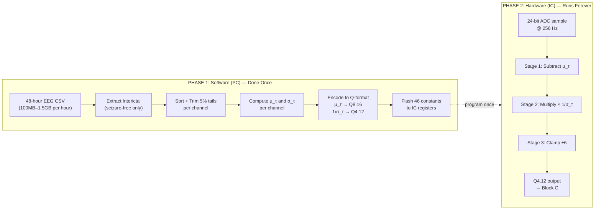
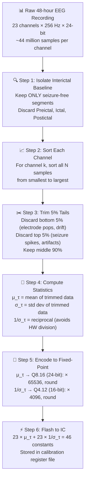

# Z-Score Normalization — Full Pipeline Visualization

## The Big Picture: Two Phases



---

## Phase 1: What You Do in Software (Before the IC Ever Runs)

This is the **offline calibration** step. You run this once per patient on a PC, using the clinical recording data.

### Step-by-Step Walkthrough



### Concrete Example (Your Testbench Data)

Here's exactly what the software does with your 256-sample dataset:

````carousel
### Step 1–2: Raw Data (256 samples, unsorted)
```
Sample values range: -41.22 to +47.08
       ▲
  47.1 ┤                              ●              ●
       │                      ●     ●   ●     ●        ●
  30.0 ┤               ●    ●  ●  ●       ● ●    ●●
       │            ● ●  ●●    ●       ●          ●●
  15.0 ┤        ●●●   ●              ●
       │   ●  ●●                               ●●
   0.0 ┤──●─────────────────────────────────●●─────────
       │ ● ●                              ●●
 -15.0 ┤  ● ● ●                     ● ●●
       │   ●● ●●                  ●●●●
 -30.0 ┤    ●●● ●●●           ●●●●
       │      ●●●●●●●●    ●●●●
 -41.2 ┤         ●●●●●●●●●●
       └───────────────────────────────────────────────
         0        64       128       192       256
```
These raw values have a wide amplitude range and significant baseline offset.
<!-- slide -->
### Step 3: Sort + Trim 5% (12 samples each tail)
```
         DISCARDED          KEPT (232 samples)            DISCARDED
         ◄──12──►  ◄────────── 90% ──────────────►  ◄──12──►
                   
  -41.22 ██████████░░░░░░░░░░░░░░░░░░░░░░░░░░██████████ +47.08
         ▲ pops    ▲                           ▲    ▲ artifacts
         artifacts │                           │    spikes
                   -36.53                     +42.39
                   
  The trimmed subset removes the 12 most extreme values 
  from each end, rejecting electrode artifacts and cable pops.
```
<!-- slide -->
### Step 4: Compute Statistics from Trimmed Data
```
  From the 232 retained samples:

  ┌─────────────────────────────────────────┐
  │  μ_τ  = 2.920298   (trimmed mean)      │
  │  σ_τ  = 16.545390  (trimmed std dev)   │
  │  1/σ_τ = 0.060440  (reciprocal)        │
  └─────────────────────────────────────────┘
  
  μ_τ ≈ 2.92 means the baseline is slightly positive.
  σ_τ ≈ 16.55 means normal brain activity spans about 
  ±16.5 units from the mean.
```
<!-- slide -->
### Step 5: Encode to Fixed-Point
```
  ┌────────────────────────────────────────────────────┐
  │  μ_τ in Q8.16 (24-bit signed):                    │
  │    2.920298 × 65536 = 191385                       │
  │    Binary: 0000 0010 1110 1011 1001 1001           │
  │    Hex:    0x02EB99                                │
  │                                                    │
  │  1/σ_τ in Q4.12 (16-bit signed):                  │
  │    0.060440 × 4096 = 248                           │
  │    Binary: 0000 0000 1111 1000                     │
  │    Hex:    0x00F8                                   │
  └────────────────────────────────────────────────────┘
  
  These 2 constants (× 23 channels = 46 total) are 
  flashed into the IC's register file. Done forever.
```
````

---

## Phase 2: What the Hardware Does (zscore_norm.sv)

This runs continuously on the IC, processing every incoming EEG sample in real-time.

### Pipeline Timing Diagram

```
Clock:    ___╱‾‾‾╲___╱‾‾‾╲___╱‾‾‾╲___╱‾‾‾╲___╱‾‾‾╲___╱‾‾‾╲___╱‾‾‾╲___
x_valid:  ────────╱‾‾‾‾‾‾‾‾‾‾‾‾‾‾‾‾‾‾‾‾‾‾‾‾‾‾‾‾‾‾‾‾‾‾‾‾‾‾‾╲────────
x_raw:    ────────< S[0] >< S[1] >< S[2] >< S[3] > ... < S[255] >────

              ┌─────────┐
  Stage 1     │ SUB μ_τ │   S[0]    S[1]    S[2]    S[3]  ...  S[255]
              └─────────┘
              ┌─────────┐
  Stage 2     │ MUL 1/σ │           S[0]    S[1]    S[2]  ...  S[254]  S[255]
              └─────────┘
              ┌─────────┐
  Stage 3     │  CLAMP  │                   S[0]    S[1]  ...  S[253]  S[254]  S[255]
              └─────────┘

z_valid:  ──────────────────────────╱‾‾‾‾‾‾‾‾‾‾‾‾‾‾‾‾‾‾‾‾‾‾‾‾‾‾‾‾‾‾‾‾‾‾‾‾‾‾‾╲──
z_out:    ──────────────────────────< Z[0] >< Z[1] > ...  < Z[254] >< Z[255] >──

Latency: 3 cycles │◄──────────────►│
Throughput: 1 sample/cycle after initial latency
```

### What Happens to Each Sample (Numeric Example)

Taking sample `[0]`: raw value = **-10.7448**

````carousel
### Stage 1: Mean Subtraction
```
  x_raw  = -10.7448  (in Q8.16: -704047 = 0xF5478F... wait)
  
  Actually let's trace the real math:
  
  Q8.16 encoding:
    x_raw  = round(-10.7448 × 65536) = -704,047
    mu_tau = round( 2.9203 × 65536)  =  191,385
  
  ┌──────────────────────────────────────────┐
  │  diff = x_raw - mu_tau                   │
  │       = -704,047 - 191,385               │
  │       = -895,432                         │
  │                                          │
  │  As real: -895,432 / 65536 = -13.6651    │
  │  Expected: -10.7448 - 2.9203 = -13.6651 ✓│
  └──────────────────────────────────────────┘
```
<!-- slide -->
### Stage 2: Multiply by 1/σ_τ
```
  diff      = -895,432  (Q8.16, 24-bit)
  inv_sigma = 248       (Q4.12, 16-bit)
  
  ┌──────────────────────────────────────────┐
  │  product = diff × inv_sigma              │
  │         = -895,432 × 248                 │
  │         = -222,067,136                   │
  │                                          │
  │  This is Q12.28 (40-bit signed)          │
  │  28 fractional bits                      │
  └──────────────────────────────────────────┘
  
  To convert to Q4.12:
    Round: add 2^15 = 32768
    -222,067,136 + 32,768 = -222,034,368
    
    Shift right by 16:
    -222,034,368 >>> 16 = -3,388
    
  As Q4.12 real: -3,388 / 4096 = -0.8271
  Expected: -13.6651 × 0.060440 = -0.8262
  Error: 0.0009 (< 0.005 threshold) ✓
```
<!-- slide -->
### Stage 3: Saturation Clamp
```
  shifted = -3,388  (Q4.12)
  
  Clamp thresholds:
    +6.0 = +24,576  (Q4.12)
    -6.0 = -24,576  (Q4.12)
  
  ┌──────────────────────────────────────────┐
  │  Is -3,388 > +24,576?   NO              │
  │  Is -3,388 < -24,576?   NO              │
  │  → Pass through unchanged               │
  │                                          │
  │  z_out = -3,388  (0xF2C4 hex)            │
  │  As real: -0.8271                        │
  └──────────────────────────────────────────┘
  
        -6     -3    -0.83   0      +3     +6
    ─────┤──────┤──────┼──────┤──────┤──────┤─────
   CLAMP │      │   ▲  │      │      │ CLAMP
         │      │   │  │      │      │
         │      │  HERE│      │      │
         │      │      │      │      │
    Well within ±6σ — no clipping needed.
```
````

### What the Clamp Actually Protects Against

```
  Normal EEG (your test data):     Electrode pop / cable disconnect:
  
  ▲ z-score                         ▲ z-score
  │                                 │
 +6 ─ ─ ─ ─ ─ ─ ─ ─ ─ ─ ─        +6 ─ ─ ─ ─ ─ ─ ─ ─ ─CLAMP─
  │                                 │               ████
 +3 │    ╱╲  ╱╲                    +3 │              █  
  │   ╱╲╱  ╲╱  ╲                    │              █   
  0 ──╱──────────╲──              0 ──────────────█────
  │               ╲╱╲              │              █    
 -3 │                              -3 │                 
  │                                 │                   
 -6 ─ ─ ─ ─ ─ ─ ─ ─ ─ ─ ─        -6 ─ ─ ─ ─ ─ ─ ─ ─ ─ ─ ─ ─
  
  All within [-2.67, +2.67]         Without clamp: z = +15!
  0 samples clipped ✓               Clamp caps it at +6 ✓
```

---

## Software Checklist (What You Build Before This Stage)

> [!IMPORTANT]
> This is the Python/MATLAB script you need to write. It runs once on a PC, takes the patient's clinical data, and outputs the 46 constants to flash into the IC.

### Input
- 48-hour clinical EEG recording (CSV files, 23 channels × 256 Hz × 24-bit)
- Labels identifying which segments are Interictal (seizure-free)

### Processing Steps

| Step | What to Do | Python Function |
|---|---|---|
| 1 | Load CSV, extract interictal-only segments | `pandas.read_csv()` + label filtering |
| 2 | For each of 23 channels: sort values | `numpy.sort(channel_data)` |
| 3 | Trim 5% from each tail | `channel_data[N*0.05 : N*0.95]` or `scipy.stats.trim_mean()` |
| 4 | Compute μ_τ and σ_τ from trimmed data | `numpy.mean()`, `numpy.std()` |
| 5 | Compute 1/σ_τ | `1.0 / sigma_tau` |
| 6 | Encode μ_τ to Q8.16 | `round(mu_tau * 65536)` → 24-bit signed int |
| 7 | Encode 1/σ_τ to Q4.12 | `round(inv_sigma * 4096)` → 16-bit signed int |
| 8 | Write to header/binary file | Output 46 constants for IC programming |

### Output
A file (or register map) containing:

```
Channel  μ_τ (Q8.16 hex)  1/σ_τ (Q4.12 hex)
──────── ──────────────── ─────────────────
  Ch 0   0x02EB99         0x00F8
  Ch 1   0x??????         0x????
  ...
  Ch 22  0x??????         0x????
```

> [!NOTE]
> You already have a working prototype of this in [zscore_calibration.py](file:///s:/projects/Main%20Project/scratch/zscore_calibration.py). That script does Steps 2–7 for a single channel using the testbench data. For production, you'd expand it to loop over all 23 channels and read from the actual clinical CSV files.
